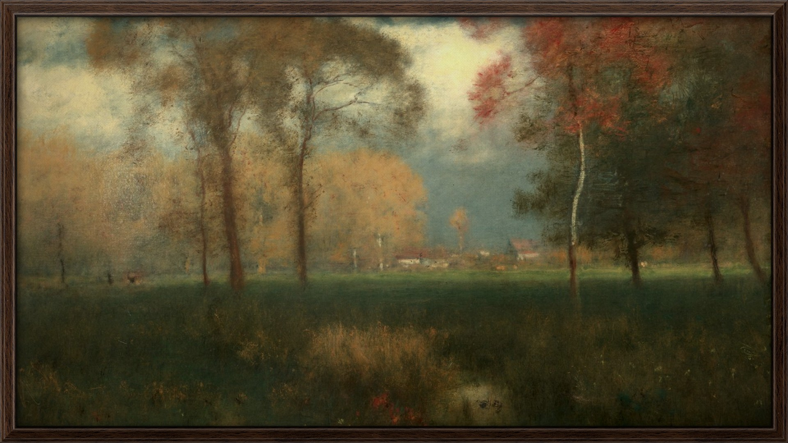
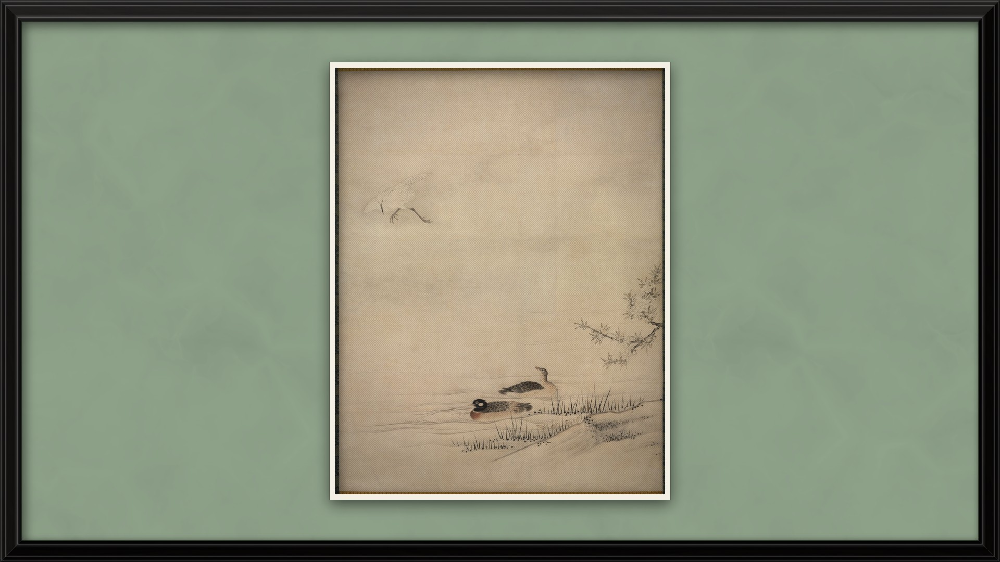
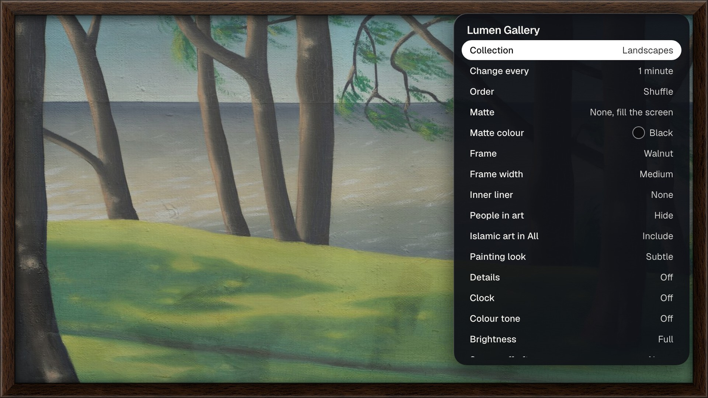

# Lumen Gallery

An art-mode screensaver for LG webOS TVs, like the art mode on Samsung's The Frame: paintings and Islamic art shown full screen in a real-looking
frame, with a slideshow. Companion to [Lumen](https://github.com/ammar027/lumen-webos), the launcher.

## Screenshots

Made from the dev preview at 1920 x 1080 (`node tools/screenshots.mjs`).





## Features

- **Pictures:** about 7,000 public-domain works: European and American paintings, Asian paintings and prints (Cleveland Museum of Art, CC0) and Islamic art,
  such as calligraphy, Quran manuscripts, tiles, carpets, domes and geometric ornament (Cleveland Museum of Art and Wikimedia Commons).
  The pictures are loaded from the internet when they are shown; nothing is stored on the TV.
- **People in art:** hidden by default (works with people or faces are filtered out; a work counts as people-free only when its title or description says it is a
  landscape, sea, flowers, still life, ornament or similar). It is best effort, not a guarantee. It can be switched on.
- **Look:** fill the screen or keep the whole picture; mattes (modern, wide, flexible, shadowbox) in 16 colours; 10 frame finishes (real wood and metal photo textures),
  4 widths and an inner liner; a canvas-weave and picture-light "real painting" effect; warmer tone at night; dimming; clock; caption with credit.
- **Not an LCD look:** a "Display look" setting (Screen, Print, Gallery) makes the TV read like paint lit by a room: blacks are lifted a little, whites are softened to paper white, and the light falls off from the top left, since an even glow and pure blacks are what give a screen away.
- **Animals in art:** also hidden by default (works whose title or description mentions an animal, bird, fish, insect or other creature). It is a text-based filter, so a picture can slip through: press Down, then **Hide**, and that picture is never shown again (*Show hidden pictures again* in the settings brings them back).
- **Quick actions:** press Down for Previous, Like / Unlike, Hide and Next; Left and Right change the picture; with the Magic Remote, arrows appear at the left and right edges.
- **Slideshow:** 15 seconds to a day, shuffle or in order, collections, favourites.
- **As the TV screensaver:** with the TV-side watcher from [Lumen](https://github.com/ammar027/lumen-webos) (`tools/tv/watch.sh`) and a flag file, Lumen Gallery
  takes over when the TV's screensaver would start. It can be switched in the app's settings.

## Keys

Left/Right: previous/next. Up: like or unlike. Down: quick actions (Previous, Like/Unlike, Hide, Next). OK: settings. Back: leave. Magic Remote: click opens settings, wheel changes picture.

## Easy install: download the .ipk

Download `com.ammar027.lumen.gallery_1.0.1_all.ipk` from the [latest release](https://github.com/ammar027/lumen-gallery-webos/releases/latest) and install it on your TV:

- **With a mouse and no command line:** open [Dev Manager Desktop](https://github.com/webosbrew/dev-manager-desktop/releases), add your TV, go to *Apps* and drop the `.ipk` onto the window.
- **Or** with the webOS CLI: `npx -p @webos-tools/cli ares-install --device lgtv com.ammar027.lumen.gallery_1.0.1_all.ipk`.

## Build and install

Needs Node 18+ and the webOS CLI (`@webos-tools/cli`).

```sh
npm install
npm run build && npm run package
npx -p @webos-tools/cli ares-install --device lgtv build/*.ipk
```

## The art list

`src/config/art.ts` is generated from public APIs; rebuild it with:

```sh
python3 tools/harvest_cma.py        # Cleveland Museum of Art Open Access API -> tools/cma.json
python3 tools/harvest_commons.py    # Wikimedia Commons Islamic categories -> tools/commons.json
python3 tools/build_art.py          # sorts into collections, flags works with people -> src/config/art.ts
```

## Credits and licence

Code: [MIT](LICENSE). Pictures and other material: see [NOTICES.md](NOTICES.md). Not affiliated with Samsung, Apple or LG Electronics.
